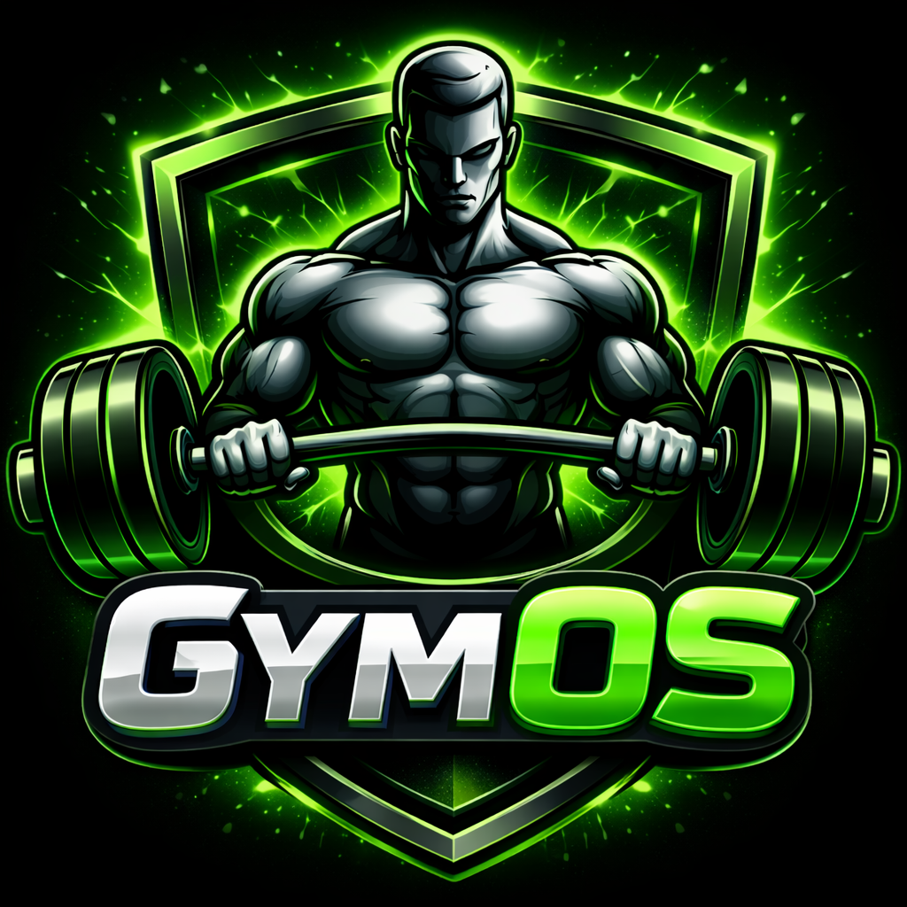

<div align="center">
  

  # GymOS

  **Offline-first fitness and nutrition app built with Flutter: workout logging, barcode scanning, on-device OCR of nutrition labels and optional Firebase sync.**

  
  
  
  
  
  
</div>

> Personal project by **Henrique Correia** (2026). Designed and built end to end. About 30,000 lines of Dart.

> [!IMPORTANT]
> GymOS gives fitness and nutrition estimates for information only. It is not a medical device and does not replace professional advice.

## Highlights

- **Offline-first:**
  - all working data lives in a local **Isar** database, so the app is fully usable without a network;
  - the cloud is optional.
- **Cloud sync per entity:**
  - foods, daily logs, weight entries, exercise sets and workout plans each sync to **Cloud Firestore** on their own;
  - uses batched writes and merge updates;
  - full restore from the cloud on a new device.
- **Computer vision on the device:**
  - barcode scanning with ML Kit and `mobile_scanner`, with lookups in the **OpenFoodFacts** database;
  - **OCR of nutrition labels** with ML Kit Text Recognition, which reads calories and macros from a photo.
- **Security by rules:** Firestore security rules (versioned in the repo) keep each user's data under `users/{uid}`.
- **Reporting:** PDF nutrition reports, progress charts, and JSON backup and restore.
- **Multilingual:** Portuguese, English and Spanish, with light, dark and AMOLED themes.

## Architecture

```text
┌──────────────── Flutter UI (screens, widgets) ────────────────┐
│ workouts · nutrition · progress · tools · settings            │
└───────────────────────────────┬───────────────────────────────┘
                                │ Riverpod providers
┌───────────────────────────────▼───────────────────────────────┐
│ Isar (local source of truth) ── JSON backup / restore          │
└──────┬───────────────────────────────┬────────────────────────┘
       │ CloudSyncService (optional)   │ device services
┌──────▼────────────┐        ┌─────────▼───────────────────────┐
│ Firebase Auth +   │        │ ML Kit barcode + text OCR        │
│ Cloud Firestore   │        │ OpenFoodFacts API · PDF · charts │
│ (rules per user)  │        └─────────────────────────────────┘
└───────────────────┘
```

## Features

**Workouts**
- Multi-day workout plans and built-in templates.
- Set-by-set logging of weight and repetitions.
- Rest timer that keeps running while you move between exercises.
- Workout history, load progression per exercise and one-rep-max estimates.

**Nutrition**
- Calories, protein, carbohydrates and fat across configurable meals.
- Foods from OpenFoodFacts, barcode scanning, nutrition-label OCR and custom foods.
- Copy and reorder meal entries.
- PDF nutrition reports.

**Progress and tools**
- Body-weight history and progress charts.
- Calorie and macro targets.
- Batch, cereal and real-weight calculators.

## Tech stack

| Area | Technology |
|---|---|
| App | Flutter, Dart, Riverpod |
| Local database | Isar |
| Auth and cloud | Firebase Auth, Google Sign-In, Cloud Firestore and security rules |
| Vision | Google ML Kit (barcode scanning, text recognition), `mobile_scanner` |
| Data | OpenFoodFacts API |
| Output | `fl_chart`, `pdf`, `printing` |

## Getting started

Requires the Flutter SDK (Dart `>=3.0.0 <4.0.0`), the Android SDK and a Firebase project. Use the FlutterFire CLI and the Firebase CLI to set it up.

```bash
git clone https://github.com/henrique-correia-it/gym_os.git
cd gym_os
flutter pub get
flutter gen-l10n
```

**1. Firebase configuration.** Create your own Firebase project, then run:

```bash
dart pub global activate flutterfire_cli
flutterfire configure
```

This generates `lib/firebase_options.dart` and `android/app/google-services.json`. Both are ignored by Git, and templates are provided as `*.example`.

**2. Enable services.** In the Firebase console:
- turn on Google sign-in;
- create a Firestore database;
- add the Android SHA fingerprints.

**3. Deploy the security rules**

```bash
firebase use YOUR_PROJECT_ID
firebase deploy --only firestore:rules
```

**4. Run**

```bash
flutter run
```

The app works fully offline. Firebase is only used for sign-in and optional sync.

## Project structure

```text
lib/
├── data/            Isar setup, collections, import and JSON backup
├── l10n/            translations (ARB) and generated localizations
├── providers/       Riverpod state
├── screens/         workouts, nutrition, tools and settings
├── services/        auth, Firestore sync, food API and label scanning
├── utils/           theme, calculations and helpers
└── widgets/         reusable dashboard components
assets/data/         exercise and food seed data
firestore.rules      per-user cloud access rules
test/                unit tests
```

## Quality

```bash
dart format --output=none --set-exit-if-changed .
flutter analyze
flutter test
```

The unit tests cover the calorie, BMI, one-rep-max, rest-timer and nutrition calculations. Sync and backup/restore still need integration tests.

## Privacy and security

GymOS handles personal data: body measurements, weight history, food intake and training history.

- Cloud data is stored only under the signed-in user's document, and the Firestore rules deny access to anything else.
- Firebase client configuration holds public app identifiers, not secrets.
- Service-account keys, keystores and real backups are never committed.
- Local Isar data and exported backups are not encrypted by the app, so store exports with care.

## Known limitations

- Calorie, macro and strength figures are estimates.
- OpenFoodFacts data is community-maintained.
- OCR results should be reviewed before saving.
- Android is the main target. iOS needs its own Firebase setup, and web and desktop are not supported.

## License

[MIT](LICENSE) © Henrique Correia
